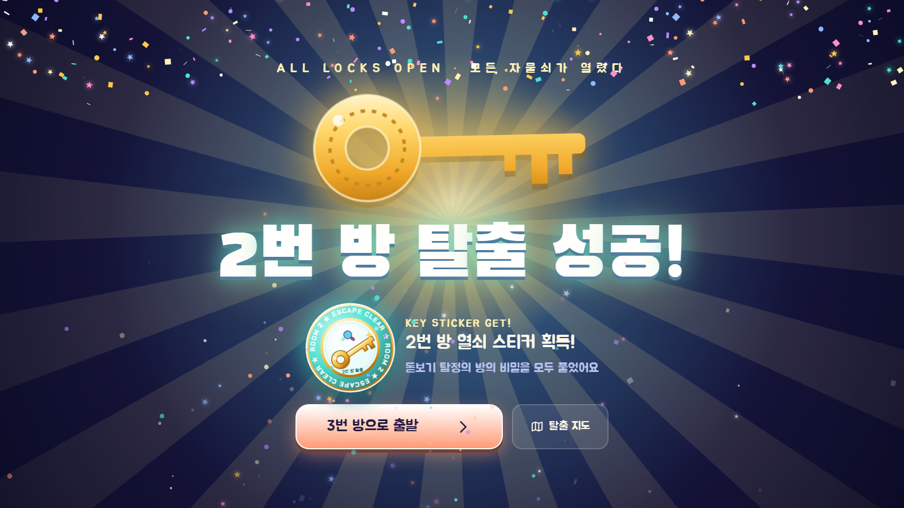
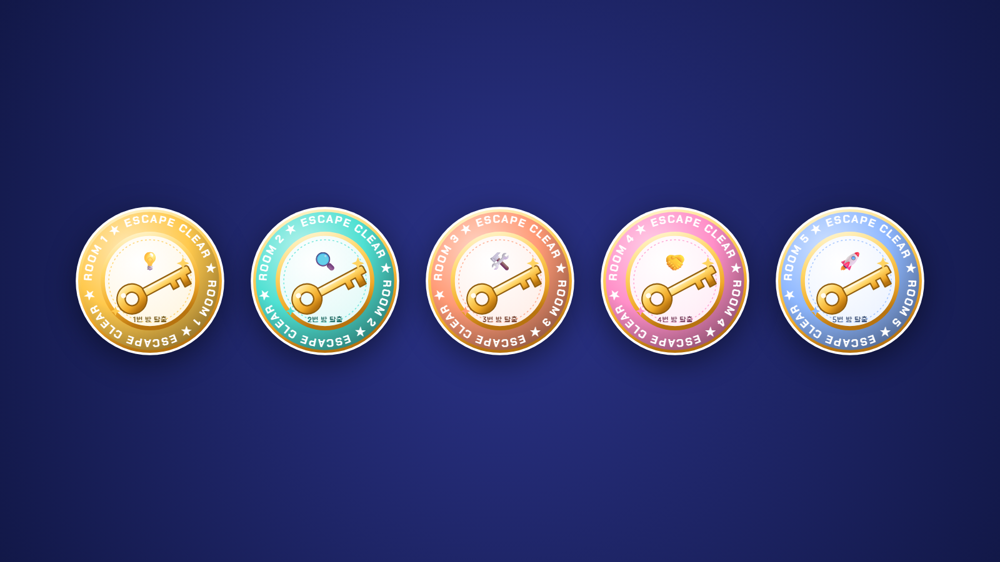
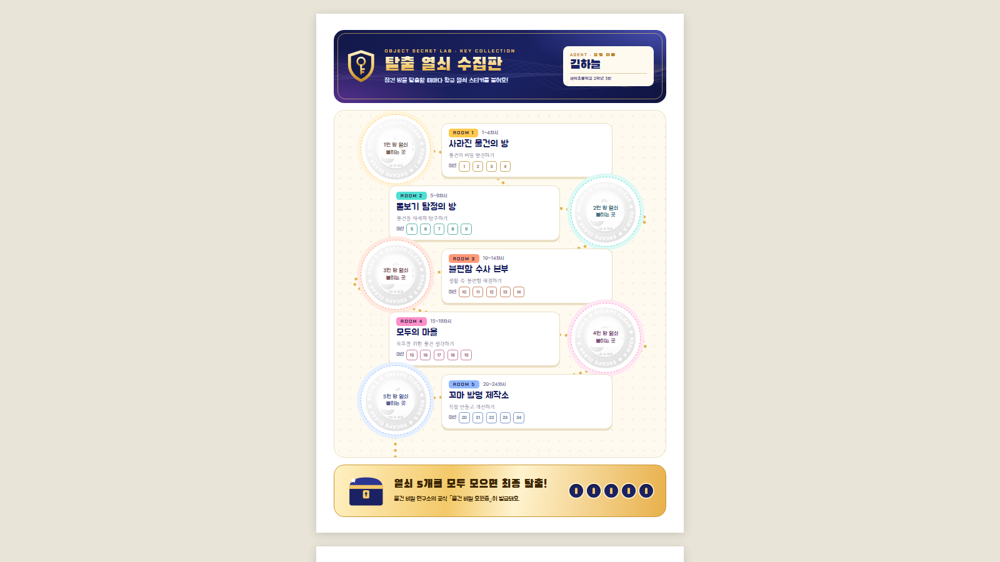
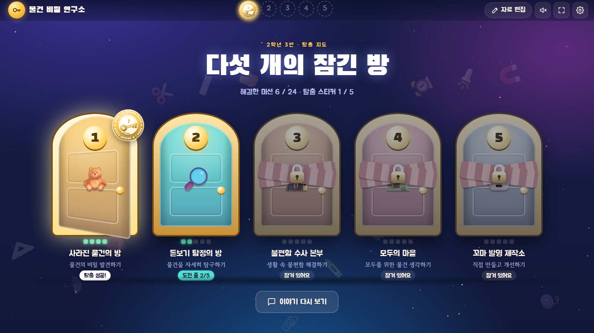
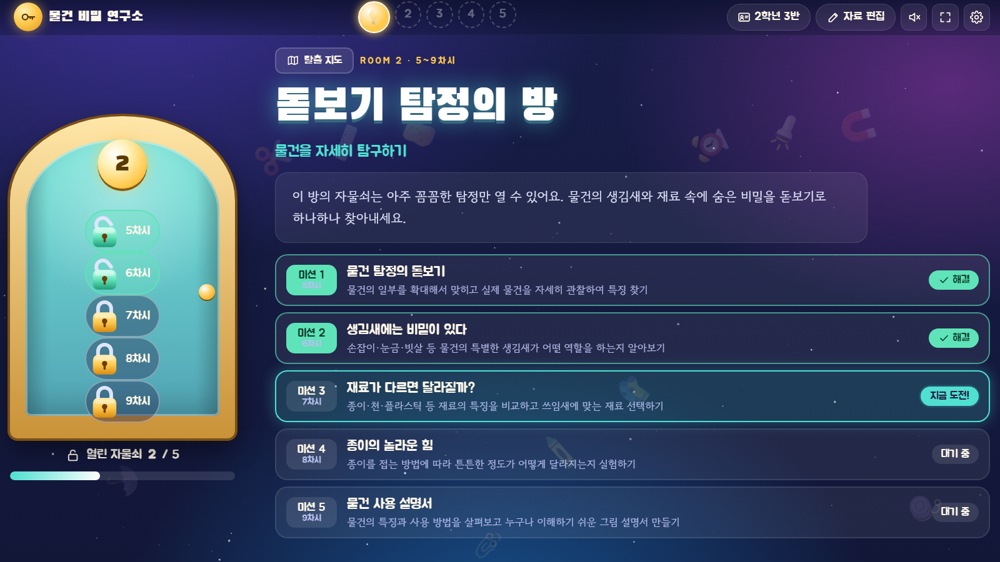
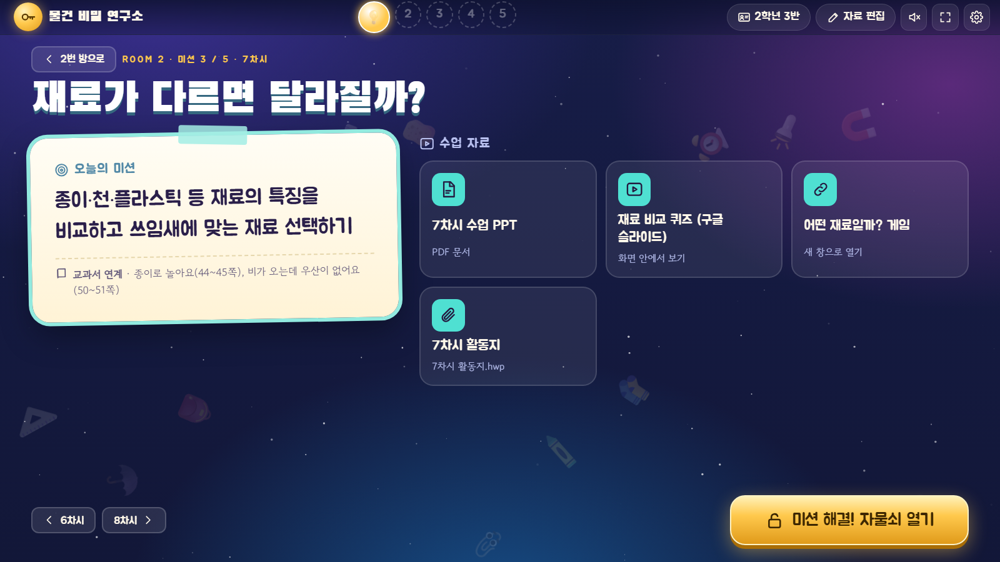

# 물건 비밀 연구소 · 방탈출 수업 웹앱

초등 '물건' 수업 24차시를 **5개의 잠긴 방**으로 묶은 방탈출 수업 웹앱이에요.
수업할 때마다 자물쇠가 하나씩 열리고, 방을 탈출하면 황금 열쇠와 탈출 스티커가 나와요. 다섯 방을 모두 탈출하면 학생 이름이 들어간 **요원증**을 인쇄할 수 있어요.

- **앱 열기**: `index.html` (GitHub Pages 주소의 첫 화면)
- **사용 설명서**: `guide.html`

| 열쇠 스티커 5종 | 열쇠 수집판 | 요원증 |
|---|---|---|
|  |  |  |

## 이런 걸 할 수 있어요

- 도입 이야기 → 방 입장(문 열림 연출) → 차시별 미션 → 자물쇠 열기 → 탈출 성공(열쇠·팡파르·스티커) → 다음 방
- 차시마다 PPT(이미지/PDF), 구글 슬라이드·캔바·유튜브 링크, 게임 링크, 활동지 파일을 넣고 앱 안에서 바로 수업
- 인쇄물: 방별 열쇠 스티커 도안(지름 36mm, 30개/장), 학생별 열쇠 수집판(A4), 요원증(신분증 크기, 8명/장)
- 백업 파일로 다른 컴퓨터에 옮기기

| 탈출 지도 | 방 화면 | 차시 화면 |
|---|---|---|
|  |  |  |

## 시작하기

1. 앱 주소를 교실 컴퓨터의 크롬이나 엣지에서 열어요. 설치나 회원가입은 필요 없어요.
2. 오른쪽 위 톱니바퀴(설정)에서 반 이름, 소속, 학생 명단을 넣어요.
3. 위쪽 **자료 편집**을 켜고 차시마다 수업 자료를 넣어요.
   PowerPoint는 **파일 → 내보내기 → 파일 형식 변경 → PNG**로 모든 슬라이드를 저장해서 한꺼번에 올리는 게 가장 좋아요.
4. **이야기 시작하기**로 첫 수업을 시작해요. 전체 화면은 `F`, 슬라이드는 `←` `→` 또는 프레젠터 리모컨.

자세한 내용은 `guide.html`을 보세요.

## 저장에 대해

진행 상황과 올린 자료는 **그 컴퓨터의 그 브라우저 안에만** 저장돼요. 서버로 아무것도 보내지 않아요.
다른 컴퓨터로 옮길 때는 **설정 → 백업 파일 내보내기 / 불러오기**를 쓰세요.

## 파일

- `index.html` — 앱 전체 (파일 하나)
- `guide.html` — 사용 설명서
- `screenshots/` — 화면 캡처
