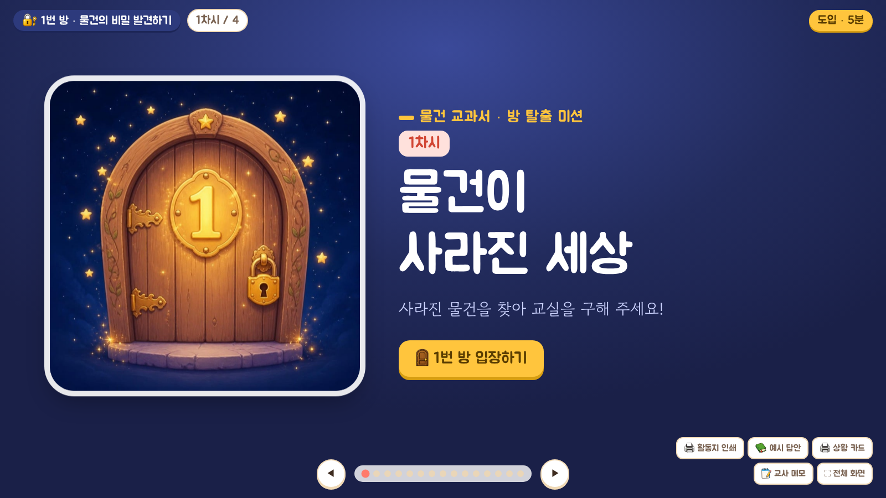
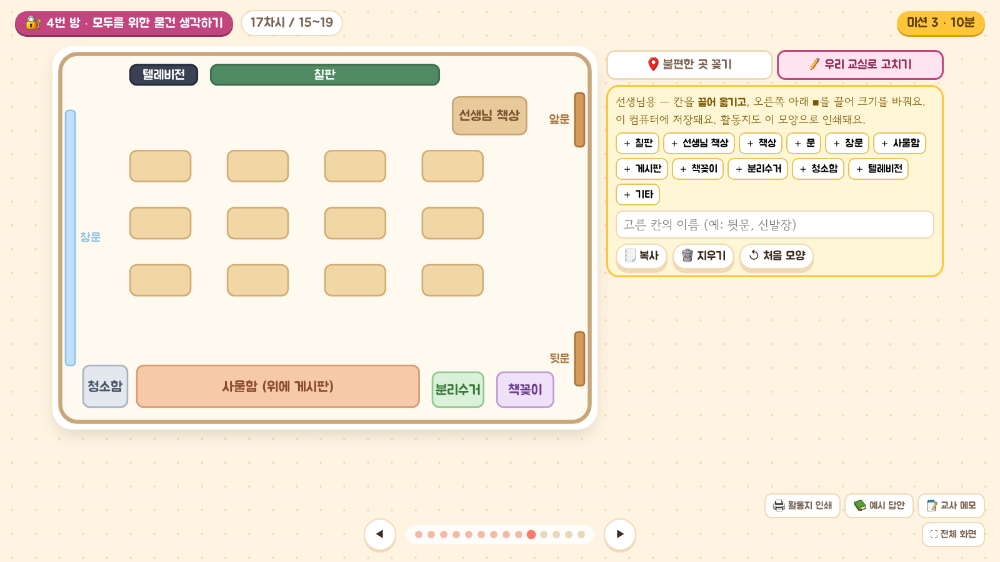
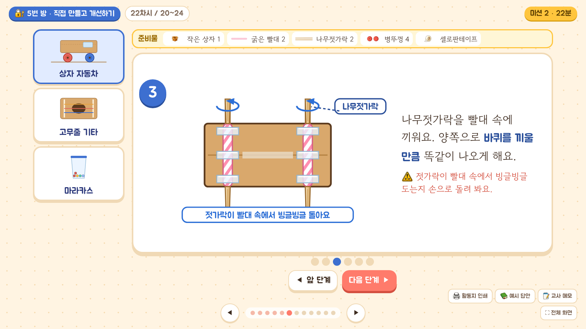
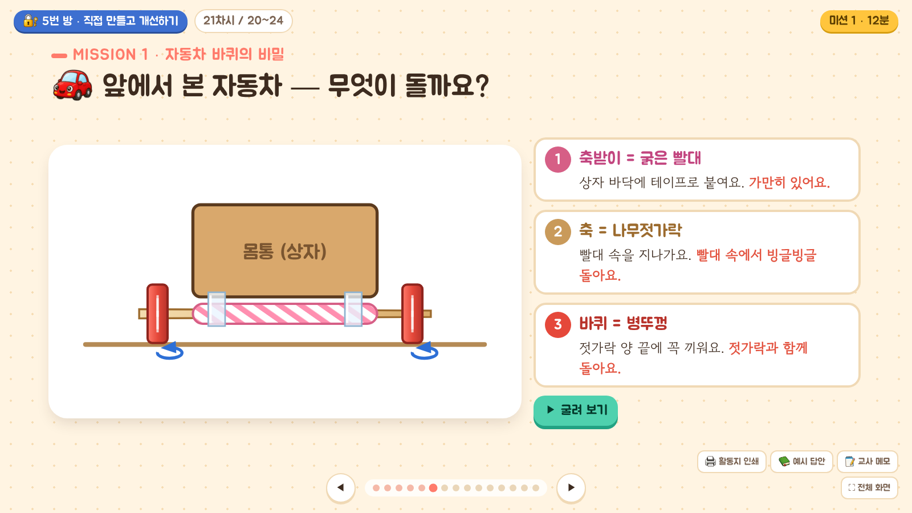
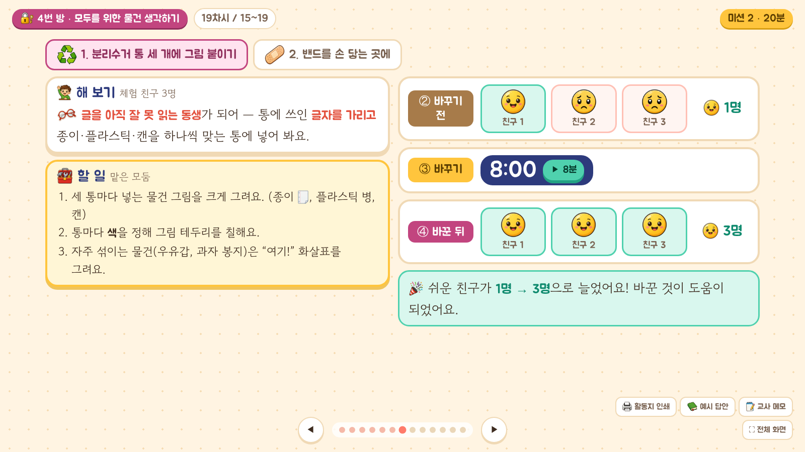
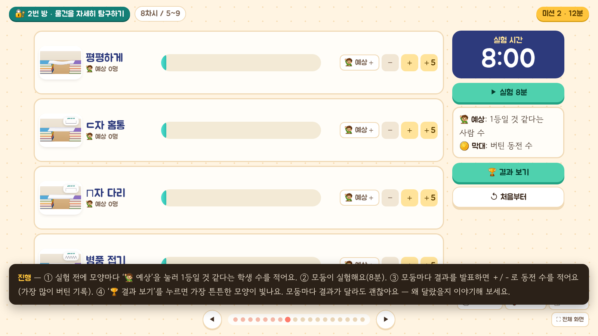

# 물건 비밀 연구소 · 방탈출 수업 웹앱

초등 '물건' 수업 24차시를 **5개의 잠긴 방**으로 묶은 방탈출 수업 웹앱이에요.
수업할 때마다 자물쇠가 하나씩 열리고, 방을 탈출하면 황금 열쇠와 탈출 스티커가 나와요. 다섯 방을 모두 탈출하면 학생 이름이 들어간 **요원증**을 인쇄할 수 있어요.

- **앱 열기**: `index.html` (GitHub Pages 주소의 첫 화면)
- **사용 설명서**: `guide.html`

| 열쇠 스티커 5종 | 열쇠 수집판 | 요원증 |
|---|---|---|
|  |  |  |

## 이런 걸 할 수 있어요

- 도입 이야기 → 방 입장(문 열림 연출) → 차시별 미션 → 자물쇠 열기 → 탈출 성공(열쇠·팡파르·스티커) → 다음 방
- 차시마다 PPT(이미지/PDF), 구글 슬라이드·캔바·유튜브 링크, 게임 링크, 활동지 파일을 넣고 앱 안에서 바로 수업
- 인쇄물: 방별 열쇠 스티커 도안(지름 36mm, 30개/장), 학생별 열쇠 수집판(A4), 요원증(신분증 크기, 8명/장)
- 백업 파일로 다른 컴퓨터에 옮기기

| 탈출 지도 | 방 화면 | 차시 화면 |
|---|---|---|
|  |  |  |

## 24차시 수업이 다 들어 있어요

차시마다 **40분 수업 화면(전자칠판용) · 활동지 · 예시 답안 · 교사 메모**가 있어요. 준비물은 교실에 있는 것과 아이들이 가져오는 재활용품 정도예요.

| 방 | 차시 | 내용 |
|---|---|---|
| 1번 방 · 사라진 물건의 방 | 1~4 | 물건이 사라진 세상, 물건에는 이유가 있다, 같은 일을 하는 다른 물건, 물건의 변신 |
| 2번 방 · 돋보기 탐정의 방 | 5~9 | 물건 탐정의 돋보기, 생김새의 비밀, 재료가 다르면?, 종이 다리 실험, 물건 사용 설명서 |
| 3번 방 · 불편함 수사 본부 | 10~14 | 발명의 시작, 불편함 수사대, 발명의 세 가지 마법(더하기·빼기·바꾸기), 지우개 문제 해결, 내 물건 업그레이드 |
| 4번 방 · 모두의 마을 | 15~19 | 모두에게 쉬울까?, 친절한 물건, **우리 교실 불편함 지도**, 모두를 위한 작은 발명, 교실 진짜로 바꾸고 전·후 비교 |
| 5번 방 · 꼬마 발명 제작소 | 20~24 | 재활용품의 두 번째 인생, 놀잇감 설계, 놀잇감 만들기(단계 그림), 실패해도 다시 도전, 튼튼한 물건의 비밀 |

- 수업 화면 오른쪽 아래: **활동지 인쇄 · 예시 답안 · 교사 메모 · 전체 화면**
- 17차시 교실 지도는 **선생님이 우리 교실 모양으로 고쳐서** 쓸 수 있어요(‘우리 교실로 고치기’).
- 정답만 찾는 활동보다 **좋은 점 · 걱정되는 점 · 이렇게 하면?** 으로 생각을 넓혀요.

| 수업 시작 | 교실 지도 고치기 | 만들기 단계 그림 |
|---|---|---|
|  |  |  |

| 원리 설명 | 바꾸기 전·후 비교 | 모둠 실험 + 교사 메모 |
|---|---|---|
|  |  |  |

## 시작하기

1. 앱 주소를 교실 컴퓨터의 크롬이나 엣지에서 열어요. 설치나 회원가입은 필요 없어요.
2. 오른쪽 위 톱니바퀴(설정)에서 반 이름, 소속, 학생 명단을 넣어요.
3. 위쪽 **자료 편집**을 켜고 차시마다 수업 자료를 넣어요.
   PowerPoint는 **파일 → 내보내기 → 파일 형식 변경 → PNG**로 모든 슬라이드를 저장해서 한꺼번에 올리는 게 가장 좋아요.
4. **이야기 시작하기**로 첫 수업을 시작해요. 전체 화면은 `F`, 슬라이드는 `←` `→` 또는 프레젠터 리모컨.

자세한 내용은 `guide.html`을 보세요.

## 모든 선생님께 PPT 나누기 (기본 자료)

`materials/07/` 처럼 차시 번호로 시작하는 폴더에 슬라이드 이미지, PDF, 활동지, `links.txt`를 올리면 배포할 때 목록이 자동으로 만들어져 모든 선생님 앱의 그 차시에 "기본 자료"로 나타나요. 자세한 방법은 [materials/README.md](materials/README.md)를 보세요.

## 저장에 대해

진행 상황과 올린 자료는 **그 컴퓨터의 그 브라우저 안에만** 저장돼요. 서버로 아무것도 보내지 않아요.
다른 컴퓨터로 옮길 때는 **설정 → 백업 파일 내보내기 / 불러오기**를 쓰세요.

## 파일

- `index.html` — 앱 전체 (파일 하나)
- `guide.html` — 사용 설명서
- `screenshots/` — 화면 캡처
- `materials/` — 모든 선생님께 보이는 차시별 기본 자료
- `lessons/` — 차시별 수업 화면(HTML 슬라이드·게임). `lessons/01/` = 1차시, 글꼴은 `lessons/fonts/` 공용. 수업 화면이 `{type:'lesson-complete', lesson:차시}` 메시지를 보내면 앱이 그 차시 자물쇠를 열어요.
